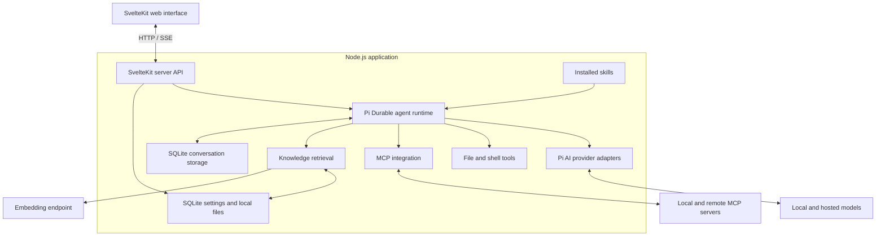

# ChatOllama

ChatOllama is an open source agentic app for running AI agents across local and
hosted models. Built on **Pi Durable**, it provides a **SvelteKit** web interface
for persistent agent conversations, document knowledge bases, and tools. Data is stored locally in SQLite and files, with no separate
database or vector service required.

## Features

- **Chat with your choice of model:** connect AI providers or local models through
  OpenAI-compatible endpoints, including Ollama, and switch models within a conversation.
- **Persistent conversations:** stream responses, inspect tool activity, and keep
  tasks running after closing the browser.
- **Document knowledge bases:** upload PDF, Markdown, and plain-text documents,
  then ask questions with source citations.
- **Agent tools:** use built-in file and shell tools, or connect local and remote
  tools through Model Context Protocol (MCP).
- **Reusable skills:** install skills and choose which ones are available in each
  conversation.

## Architecture

SvelteKit serves the web interface and API. Pi Durable runs agents and persists
conversation state; Pi AI connects them to local and hosted models.



## Build and run locally

Install **Node.js 24** and **pnpm 10.8.1**, then clone the repository and build
from `rewrite/`, the SvelteKit application directory:

```sh
git clone https://github.com/sugarforever/chat-ollama.git
cd chat-ollama/rewrite
pnpm install
pnpm build
```

Configure a chat endpoint and start the app. This example uses a running local
Ollama server; replace `your-chat-model` with an installed model ID:

```sh
export HOST='127.0.0.1'
export ORIGIN='http://localhost:3000'
export CHAT_BASE_URL='http://127.0.0.1:11434/v1'
export CHAT_MODEL_ID='your-chat-model'
# Export CHAT_API_KEY if your provider requires an API key.

pnpm start
```

Open [http://localhost:3000](http://localhost:3000). You can add providers and
change models in **Settings**. Configure a separate embedding endpoint and
model there before indexing knowledge documents.

`pnpm start` does not load `.env` automatically; export variables in your shell.
Data is saved in `rewrite/data` by default. Set `DATA_DIR` to use another location.
The app has no login, so the example binds it to your local computer.

See the [application guide](rewrite/README.md) for detailed configuration and
Docker instructions, or the [provider guide](rewrite/docs/provider-auth.md)
for provider authentication.
