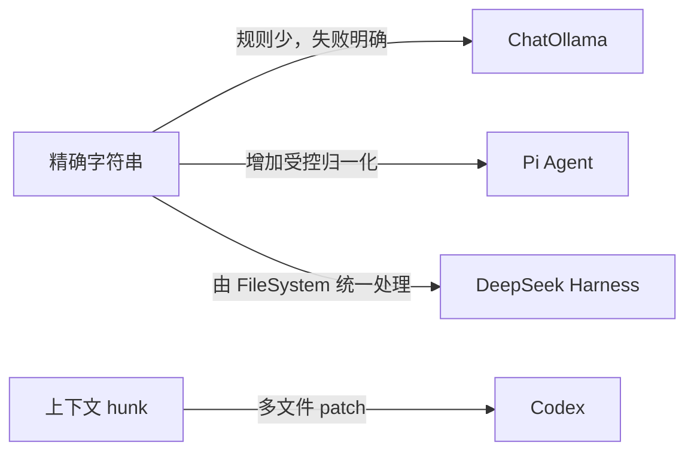

给 `ChatOllama` 增加 `write_file` 和 `edit_file` 以后，我很快发现，“让 Agent 写一个文件”远不是调用一次 `writeFile` 那么简单。两个工具一旦进入真实的 Agent Loop，路径逃逸、符号链接、并发覆盖、旧内容误写、半截文件和批量编辑的一致性就会同时出现。

为了给这两个工具确定边界，我重新查看了 `Codex`、`Pi Agent` 和 `DeepSeek Harness` 的当前公开源码。它们分别从 patch 语言、可控的字符串替换和文件系统 contract 出发，给了我三种不同的参考。这篇会记录我从这些实现中看到的取舍，以及它们怎样影响了 ChatOllama 的设计。期望对大家有所帮助。

## 写与改的差异

`write` 和 `edit` 给模型的参数不同，但在文件系统一侧，它们最终都要完成同一件事：把目标文件从版本 A 变成版本 B。

`write` 通常由模型提供完整的新内容，原内容即使存在也不参与变换。`edit` 则要先读 A，根据某种编辑描述计算 B，再写回去。差异集中在中间这一步：字符串替换工具说“找到这段旧文本，换成新文本”，patch 语言描述“在这些上下文行之间，删除和增加这些行”。

```text
write(path, content)
  target = resolve(path)
  publish(target, content)

edit(path, change)
  target = resolve(path)
  original = read(target)
  updated = apply(original, change)
  publish(target, updated)
```

这段伪代码省略了最难的部分：
- `resolve` 要回答模型能写哪里
- `apply` 要回答编辑究竟匹配哪一处
- `publish` 要回答失败时旧文件会不会被破坏

并发还会插进每个空隙：两个工具可能同时编辑同一文件，另一个进程也可能在 Agent 读完以后修改文件。

这也是我查看三个参考实现时使用的五个观察角度：编辑语言、匹配策略、落盘语义、并发控制和安全模型。先把结果放在一起，后面再逐项拆开。

| 角色 | 实现 | 模型面对的编辑抽象 | 默认匹配 | 单次落盘 | 并发与旧版本 | 路径边界 |
|---|---|---|---|---|---|---|
| ChatOllama 的设计结果 | ChatOllama | 单文件字符串替换，可批量 | 精确、唯一、互不重叠 | 同目录临时文件 + `fsync` + `rename` | 规范化路径队列 + 可选内容版本 | 只接受 workspace 相对路径，拒绝最终符号链接 |
| 参考实现 | Codex | 可跨文件的 patch 语言 | 上下文变更块（hunk）定位 | 通过 `ExecutorFileSystem` 逐项变更 | patch 本身没有数据库式全局事务 | 先计算所有受影响路径，再接入 sandbox 与 approval |
| 参考实现 | Pi Agent | 单文件字符串替换，可批量 | 精确优先，失败后受控归一化 | 默认直接 `writeFile` | 按真实目标路径排队，无内容版本条件 | 接受相对或绝对路径，不自行做 workspace confinement |
| 参考实现 | DeepSeek Harness | `FileSystem` contract 上的 literal edit | 精确，默认唯一，可 `replaceAll` | provider 保证原子写 | 按目标身份加锁 + 可选 version guard | sandbox provider 在写入前重新 canonicalize |

这里的“原子”必须先限定范围。同目录先创建临时文件再 `rename`，或者后端承诺的 atomic mutation，通常保证的是单个目标文件不会暴露半写状态。它不等于一份涉及三个文件的 patch 是一个事务：如果前两个文件已经成功，第三个失败，系统是否会自动把前两个回滚，这是另一个话题。

## Codex 让模型提交一份 patch

首先参考是 `Codex`。这里关注的文件编辑工具是 `apply_patch`，而不是一对独立的字符串 `write`/`edit`。它的 patch 语法可以在一次调用中 Add、Update、Delete 和 Move 文件，一个 Update 又可以包含多个 hunk。[patch parser](https://github.com/openai/codex/blob/6baa076eb692b73ede097b4870dc45692c7556d9/codex-rs/apply-patch/src/parser.rs#L55-L131)

这里的 hunk 是 patch 中一段连续的变更块。它通常同时包含修改位置附近的上下文行、要删除的旧行和要加入的新行。例如下面这一个 hunk，会利用函数声明与右花括号定位中间的返回语句：

```diff
@@
 function greet() {
-  return "hello"
+  return "hello world"
 }
```

这定义了一种更灵活的模型表达修改的方式。字符串替换要求模型复制一段必须唯一的旧文本；patch hunk 则同时携带旧行、新行和上下文，还可以用函数或类定义一类的 `change_context` 缩小查找范围。Codex 会从上一个 hunk 之后继续查找，不能定位期望行就拒绝该更新。[hunk 定位](https://github.com/openai/codex/blob/6baa076eb692b73ede097b4870dc45692c7556d9/codex-rs/apply-patch/src/file_update.rs#L84-L220)

上下文 hunk 对多处代码变更更自然，也能把多个文件的意图放在同一份 diff 中。代价是工具必须拥有解析语言、定位上下文、处理文件尾和换行风格的完整实现。字符串替换的错误通常是“找不到”或“不唯一”；patch 的错误还可能来自语法、hunk 顺序、上下文漂移和移动目标。

Codex 的另一个特点是，patch 在真正执行前已经成为一组明确的文件变化。Runtime 会收集每个源路径以及 Move 的目标路径，再根据当前文件系统策略计算还缺少哪些写权限；这些路径随后进入 sandbox 和 approval 流程。[受影响路径与权限计算](https://github.com/openai/codex/blob/6baa076eb692b73ede097b4870dc45692c7556d9/codex-rs/core/src/tools/handlers/apply_patch.rs#L223-L279) 这比“执行时碰到哪个路径再说”更适合多文件操作，因为用户审批的是整份 patch 可能影响的范围。

底层执行并不绑定本机 `std::fs`，而是通过 `ExecutorFileSystem` 读取、写入、建目录和删除。公开 Runtime 会把已经验证并完成安全评估的 patch 交给相应 environment 的文件系统，并携带文件系统 sandbox context。[apply patch runtime](https://github.com/openai/codex/blob/6baa076eb692b73ede097b4870dc45692c7556d9/codex-rs/core/src/tools/runtimes/apply_patch.rs#L168-L207) 这让本地环境和远程 executor 可以共享 patch 语义，但具体隔离能力仍由公开代码中的 sandbox、approval policy 与所选 environment 决定。这里没有必要推断 Codex 产品未公开的部署细节。

需要特别注意，整份 patch 不是数据库式全局原子事务。公开实现会按变化逐项提交，并记录已经 committed 的增量；失败类型也会携带失败前确定已经完成的变更。[`ApplyPatchFailure`](https://github.com/openai/codex/blob/6baa076eb692b73ede097b4870dc45692c7556d9/codex-rs/apply-patch/src/lib.rs#L245-L302) 仓库甚至有“前面成功、后面失败后保留已完成变更”的测试场景。于是 Codex 的“一个工具调用改多个文件”不应被误读为跨文件事务。

## Pi Agent 优先提高编辑成功率

`Pi Agent` 更接近 ChatOllama 这次开发的工具形态，它同样给模型提供单文件 `write` 和 `edit`。它明确接受相对或绝对路径，相对路径按 cwd 解析；默认 `write` 会递归创建父目录，然后直接调用 Node.js `writeFile`。[`write.ts`](https://github.com/earendil-works/pi/blob/08dc60bc52d89d6823a9738cc90b1916e5e446e5/packages/coding-agent/src/core/tools/write.ts#L11-L89)

这里没有 ChatOllama 那种内建 workspace confinement，也没有临时文件 + `rename` 的本地落盘流程。直接 `writeFile` 更简单，但如果进程在覆盖过程中异常退出，不应假设旧文件或新文件必然完整保留。另一方面，Pi 把 `mkdir`、`writeFile`、`readFile` 和 `access` 包成可插拔 operations，调用方可以把写入转给 SSH 或其他后端。[`WriteOperations` 与 `EditOperations`](https://github.com/earendil-works/pi/blob/08dc60bc52d89d6823a9738cc90b1916e5e446e5/packages/coding-agent/src/core/tools/edit.ts#L79-L100) 因此默认本地语义较轻，非常易于扩展。

Pi 的 `edit` 支持同一文件的一批 `edits[]`，同样把各项匹配在原始内容上并拒绝重叠。它会先去掉 BOM 参与匹配，统一换行为 LF，修改后再恢复 BOM 和原来的主要换行风格。[编辑执行流程](https://github.com/earendil-works/pi/blob/08dc60bc52d89d6823a9738cc90b1916e5e446e5/packages/coding-agent/src/core/tools/edit.ts#L159-L210)

更与众不同的是匹配策略。Pi 先尝试精确查找；失败后才对文件和 `oldText` 做受控归一化，包括 NFKC、移除行尾空白、统一弯引号、Unicode dash 和特殊空格。归一化后仍要求目标唯一。[fuzzy normalization](https://github.com/earendil-works/pi/blob/08dc60bc52d89d6823a9738cc90b1916e5e446e5/packages/coding-agent/src/core/tools/edit-diff.ts#L27-L55) 如果一批编辑中任何一项需要模糊匹配，算法会在归一化空间计算替换，再只重写实际受影响的行，尽量保留未修改行的原始内容。

这是一种有意控制范围的 fuzzy match，不是计算编辑距离以后挑一个“最像”的位置。它能处理模型常见的弯引号、破折号、空格和换行差异，提高一次工具调用成功的概率；风险是两个原本字节不同的片段归一化后可能相同，所以实现仍坚持唯一性检查。ChatOllama 选择不做这一步，是把可预测失败放在成功率之前：匹配不上就让 Agent 重新读取和重试，不让工具替模型推断。

Pi 也对同一文件的 mutation 操作排队。已存在文件使用 `realpath` 作为 key，因此两个别名指向同一真实目标时会进入同一队列；不存在的文件退回解析后的绝对路径。[`file-mutation-queue.ts`](https://github.com/earendil-works/pi/blob/08dc60bc52d89d6823a9738cc90b1916e5e446e5/packages/coding-agent/src/core/tools/file-mutation-queue.ts#L1-L57) 这能避免 Pi 进程内两个工具的读写交错，但它没有 `expectedVersion` 一类内容条件，无法判断一次调用是否基于更早的一次观察。排队保证执行顺序，版本条件保证写入依据没有过期，两者不能互换。

## DeepSeek Harness 用 FileSystem 统一文件操作

`DeepSeek Harness` 的出发点又不同。`dsh-fs` 定义抽象 `FileSystem`，后端负责稳定 target identity、路径解析、文本解码、containment 和原子 mutation；`writeText` 与 `editText` 都属于接口，而不是本地工具代码的实现。[`FileSystem` contract](https://github.com/deepseek-ai/deepseek-harness/blob/c291e7961a515f6d7af9304e7fd1d257929aef26/packages/fs/fs/src/index.ts#L80-L116)

这层抽象把路径字符串和文件身份分开。模型提供 `displayPath`，provider 的 `resolve` 产生稳定的 `targetKey`；本地实现会让不同路径别名尽量映射到同一个真实目标。锁也按 `targetKey` 建立，因此检查、literal match 和原子写入共享一个临界区。[本地 provider 的锁与 resolve](https://github.com/deepseek-ai/deepseek-harness/blob/c291e7961a515f6d7af9304e7fd1d257929aef26/packages/fs/fs-local/src/index.ts#L71-L129)

`editText` 做的是 literal edit，不提供 Pi 那种归一化模糊匹配。默认要求 `oldString` 精确出现一次，也可以显式设置 `replaceAll`。模型侧工具先取得可选的观察版本，再把版本条件与编辑请求一起交给 provider；provider 在锁内先检查 version，再读取、匹配并原子发布。[模型侧 edit](https://github.com/deepseek-ai/deepseek-harness/blob/c291e7961a515f6d7af9304e7fd1d257929aef26/packages/fs/tool-fs/src/edit.ts#L75-L146)

本地 provider 写入时还保留原文件 mode。与 ChatOllama 把 `0600` 用在临时文件上不同，DSH 把最终文件的权限继承和原子发布作为后端语义；这使同一套上层工具能够换成本地、远程或其他执行环境，同时要求每个 provider 都实现必要的接口。[原子 mutation contract](https://github.com/deepseek-ai/deepseek-harness/blob/c291e7961a515f6d7af9304e7fd1d257929aef26/packages/fs/fs/src/index.ts#L238-L277)

文件能写到哪里，同样由后端决定。直接使用 `fs-local` 时，系统不会限制写入范围；换成 `fs-sandbox` 后，`workspace-write` 模式只允许写入指定的工作区和临时目录。

真正写入之前，`fs-sandbox` 会重新解析一次路径，取得目标此刻指向的真实位置，再检查它是否仍在允许写入的目录内。检查通过后，后续写入也使用这次新解析出的目标，而不是之前保存的旧路径。[`SandboxedFileSystem.checkedTarget`](https://github.com/deepseek-ai/deepseek-harness/blob/c291e7961a515f6d7af9304e7fd1d257929aef26/packages/fs/fs-sandbox/src/index.ts#L111-L144) 如果上级目录的符号链接已经被另一个进程替换，这次复查就能发现目标位置发生了变化。

不过，这次复查只是缩短了检查与写入之间的竞态窗口，不能完全消除 TOCTOU。它负责约束文件工具的写入位置；如果要运行不可信代码，仍然需要 shell sandbox 提供操作系统层面的隔离。

## 三种编辑语言的取舍

看完三份参考实现以后，我先比较它们的编辑语言，因为这直接决定工具愿意替模型推断多少，也影响 ChatOllama 应该把边界画在哪里。

精确字符串替换最容易审计。命中位置由字节或字符串相等决定，唯一性和重叠也容易解释。它对模型复制空白、引号和换行的准确度要求较高，因此失败率会上升。这成为 ChatOllama 的基础选择：接受明确失败，把重新读取交给 Agent Loop。

Pi 的受控归一化允许工具统一一组已知、可解释的表示差异。它没有在整个文件中寻找语义相似段落，也不在多个候选中擅自挑选，所以风险仍受到唯一匹配约束。成功率更高的同时，工具实现也必须处理归一化后的 offset 与原始内容之间的映射。

Codex 的上下文 hunk 更适合结构化代码变更。模型可以用周围代码说明位置，一次表达多个文件、多个片段和移动操作。它的复杂度不在 fuzzy，而在 patch 语言本身：parser、上下文定位、换行保存、权限集合和部分提交都成为核心机制。



DSH 声明了另一种扩展方向：模型侧仍可保持简单 literal edit，但把稳定身份、版本条件、原子写和 sandbox policy 交给 `FileSystem`。它扩展的不是编辑语言，而是执行后端。
